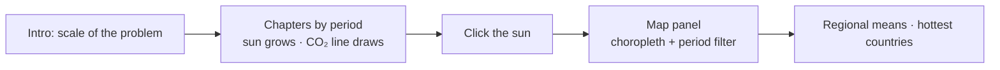
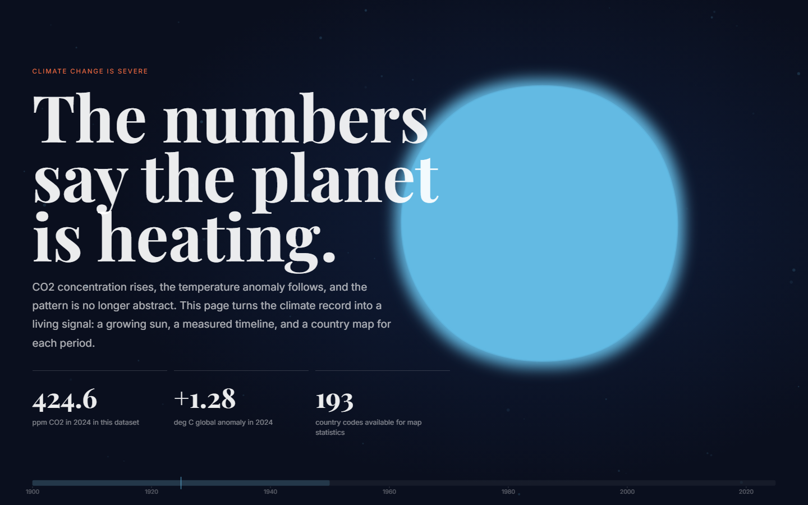
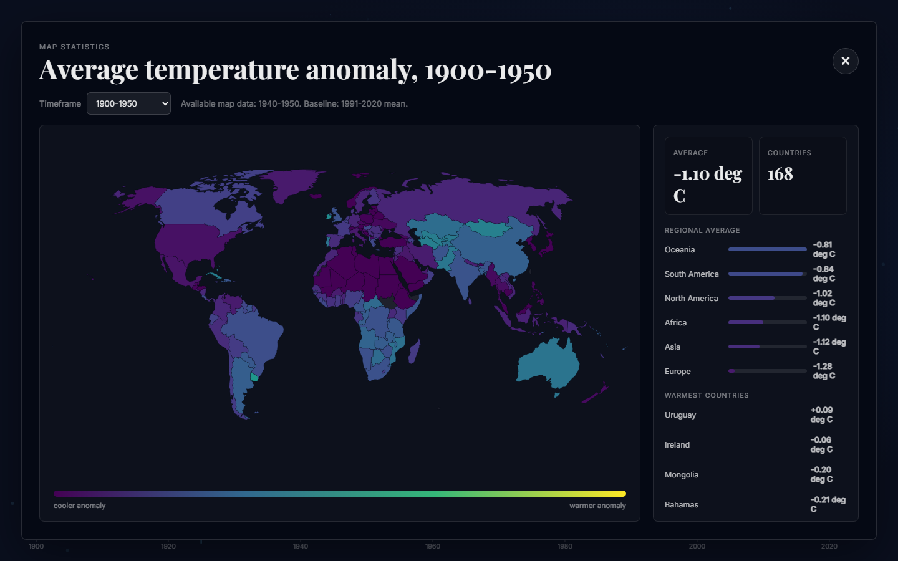

<div align="center">

# 🌍 D3 Climate Visualization — A Scrollytelling Story of a Warming World

**An interactive D3.js narrative linking CO₂ concentration, global temperature anomaly and a country-level anomaly map** (academic team project).


</div>

---

## 📌 Overview

A single-page, scroll-driven visual story. An **animated sun** grows and warms in colour as global temperature anomalies rise; a **CO₂ time series** provides the quantitative evidence; clicking the sun opens a **world choropleth map** of country-level anomalies with period filters, regional averages and a ranking of the hottest countries.

## ✨ Features

- Scrollytelling with four chapters: **1900–1950 · 1950–1980 · 1980–2010 · 2010–2024**.
- Animated SVG sun as a visual metaphor for temperature anomaly.
- CO₂ / temperature chart with **filters and hover tooltips**.
- Choropleth map (`d3.geoNaturalEarth1`, Viridis colour scale) with **period selector**, 750 ms transitions, regional means and top-hottest countries.
- Responsive SVG (`viewBox`), contrast-aware colours, `aria-label` on controls.

## 🗂️ Data

| File | Content | Source |
|---|---|---|
| `data/co2.csv` | Annual CO₂ concentration (125 rows) | <!-- CONFIRM source (e.g. NOAA / Our World in Data) --> |
| `data/gistemp.csv` | Global annual temperature anomaly (125 rows) | <!-- CONFIRM: NASA GISTEMP? --> |
| `data/country_temperature_anomaly.csv` | Annual temperature anomaly per country (≈ 18.3k rows) | Our World in Data — *Annual temperature anomalies* |
| `data/world-countries.geojson` | Country geometries with ISO3 codes | Natural Earth 1:110m |

Country data is joined to the map by **ISO3 code**.

## 🧭 Design Rationale



Design decisions, difficulties and test notes are documented in [`report/report.md`](./report/report.md) (French).

## ✅ Testing (from the project report)

The project report states: Chromium headless via Playwright at 1440 × 900 and 390 × 844, no console errors, the map opens on click, **176 country shapes** drawn, **168 countries** with data. *Independently re-checked with headless Edge / Puppeteer at 1440 × 900:* the page renders and clicking the sun opens the map with **168 countries**; the only console message was one 404 for an optional resource (probably the favicon).

## 🚀 Run Locally

The page loads CSV/GeoJSON with `fetch`, so it must be served over HTTP:

```bash
python -m http.server 8080
# open http://localhost:8080
```

D3 v7 is loaded from the `d3js.org` CDN (internet access required).

## 🖼️ Preview

<p align="center">
  
  
</p>

*Screenshots of the page served locally (`python -m http.server`): the hero (CO₂ 424.6 ppm and +1.28 °C global anomaly for 2024 in this dataset) and the map panel (period 1900–1950, 168 countries, baseline 1991–2020 mean).*

<!-- TODO(user): enable GitHub Pages and add the live link; https://nour-ghribi.github.io/d3-climate-visualization/ returned 404 when checked. -->

## 🧰 Tech Stack

| Role | Tools |
|---|---|
| Visualisation | D3.js v7 (scales, axes, `geoNaturalEarth1`, transitions) |
| Front end | HTML, CSS, JavaScript (single `index.html`) |
| Data | CSV, GeoJSON |

## 🔭 Limitations & Future Work

- Single large `index.html`; split into modules and add a build step.
- The map's baseline (1991–2020 mean) is displayed in the panel; also state it in the data credits of each source.
- Add keyboard navigation for the map and a data-download link.

## 👥 Credits

Academic data-visualization project developed as a team.

Maintained by **Nour Ghribi** · [GitHub](https://github.com/Nour-Ghribi)

## 📚 Data Credits

Our World in Data (*Annual temperature anomalies*) · Natural Earth · <!-- CONFIRM CO₂ and GISTEMP credits -->
